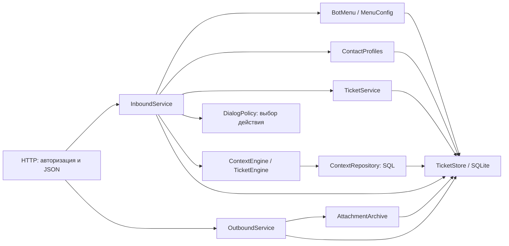

# Устройство приложения

`app.py` собирает зависимости приложения. HTTP-обработчики проверяют доступ,
читают запрос и передают данные сервисам. Сервисы диалогов и доставки можно
создавать с отдельными базами и вызывать напрямую.



| Компонент | Ответственность |
| --- | --- |
| `queue_inbound_service.py` | Транзакция входящего сообщения, проверка дубликата, последовательность шагов диалога и сбор заявки |
| `queue_contact_profiles.py` | Язык и профиль контакта, согласование телефонного номера с WhatsApp ID, разбор подразделения и должности |
| `queue_dialog_policy.py` | Выбор одного действия по состоянию диалога и сообщению, без чтения или изменения базы |
| `queue_contextual_tickets.py` | Разбор полей, уточнения, сбор черновика, правила дополнения заявки и переноса истории |
| `queue_context_repository.py` | SQL, схема и сериализация состояния, анализа сообщений, истории и полей заявки |
| `queue_bot_input.py`, `queue_bot_texts.py` | Разбор команды завершения черновика и общие тексты бота |
| `queue_message_rules.py` | Команды меню, короткие подтверждения, категория, приоритет и сводка заявки из текста сообщения |
| `queue_request_draft.py` | Поля черновика заявки (ФИО, подразделение, номер, проблема) из свободного текста и их подписи |
| `queue_menu_config.py` | Загрузка, проверка и атомарное сохранение снимка настроек |
| `queue_bot_menu.py` | Выбор категории, подписи, подсказки и меню на русском и казахском |
| `queue_menu_legacy.py` | Чтение старого формата настроек при обновлении |
| `queue_outbound_service.py` | Получение сообщения коннектором, начало отправки, результат доставки и восстановление ответа |
| `queue_attachment_archive.py` | Сохранение вложения для истории чата до очистки временного файла |
| `queue_chat_state.py` | `ChatViews`: списки чатов и групп, уведомления, сводка сохранённых данных с живым состоянием; `ConnectorState`: состояние коннектора |
| `queue_ticket_views.py` | `TicketViews`: рамка страницы (`layout`), список заявок, заявка, страницы аккаунта |
| `queue_admin_pages.py` | `AdminPages`: страницы администрирования с зависимостями в `AdminPageDependencies` |
| `queue_stale_menu.py` | `StaleMenuRecovery`: фоновый повтор меню, если входящее сообщение осталось без автоответа |
| `queue_reliability.py` | `ReliabilityMonitor`: проверки базы, диска и коннектора, тревоги, диагностика, отложенная отправка |
| `queue_productivity_http.py` | `ProductivityRoutes`: напоминания, аналитика, резервные копии, метки и поиск в чате |
| `queue_workflow_http.py` | `WorkflowRoutes`: недавние чаты, рабочие настройки, действия с заявками, экспорт чата |
| `queue_reliability_http.py` | `ReliabilityRoutes`: страница «Надёжность», диагностика, отложенные сообщения |

HTTP-модули с классами `*Routes` (также `FeatureRoutes` и `UploadRoutes`) создаются в
`app.py` и подключаются к обработчику запросов атрибутами класса (`productivity_routes`,
`workflow_routes`, `reliability_routes`, `feature_routes`, `upload_routes`), как `inbound_service`. Новые обработчики добавляйте так же, а не через `get(handler, app)`.

## Границы зависимостей

- Сервисы принимают зависимости в конструкторах. Импорт сервисного модуля не
  импортирует `app`, не запускает сервер и не открывает рабочую базу.
- `InboundService` создаёт отдельное состояние для каждого сообщения. Один
  экземпляр сервиса может обслуживать параллельные запросы.
- Переключатель автоответов передаётся в сервис отдельной функцией. Отключение
  ответа сохраняет обработку входящих данных и создание заявок.
- Отметка входящего сообщения и изменения базы выполняются одной транзакцией.
  Ответ проверяется на возможность сериализации до фиксации транзакции; HTTP
  записывает его в сокет после завершения сервиса. Сбой возвращает результат,
  допускающий повтор, и откатывает отметку дубликата.
- `MenuConfig` публикует новый снимок после успешного сохранения. Читатели получают
  копии данных и не берут блокировку записи. Это позволяет боту читать меню,
  пока администратор ожидает доступ к SQLite.
- `bot_profile_json` — источник текущего меню. `request_menu_json` сохраняется
  как совместимое представление для обновления и отката; профиль раннего патча
  `company_profile_json` переносится при отсутствии нового. Работающие компоненты
  читают профиль через `MenuConfig`.
- Словарь подписей исторических категорий передаётся явно. Списки доступных
  категорий вычисляются из текущего профиля.

Обработчик запросов получает свои зависимости набором `HttpDependencies` (атрибут
`deps`) и атрибутами с сервисами и страницами. Общий контекст приложения через
`bind()` остался только у синхронизации чатов в `queue_whatsapp_handlers`. При её
переносе используйте явные зависимости, как в остальных сервисах. `TicketStore` остаётся общим слоем SQLite.

## Хранилище SQLite

`ticketing.TicketStore` — единственный объект доступа к базе. Сам класс содержит
соединение, транзакции (`atomic`), заявки и настройки, а остальные темы подмешаны
из отдельных модулей:

| Модуль | Класс | Данные |
| --- | --- | --- |
| `queue_store_schema.py` | — | Таблицы и индексы новой базы, затем обновление старой |
| `queue_store_chat_aliases.py` | `ChatAliasStore` | Псевдонимы `@lid` и перенос их строк в чат `@c.us` |
| `queue_store_contacts.py` | `ContactStore` | Сохранённые контакты и группы, ручной режим чата |
| `queue_store_messages.py` | `MessageStore` | Чаты и сообщения WhatsApp, отметки доставки, реакции, связь с заявками |
| `queue_store_notifications.py` | `NotificationStore` | Счётчики непрочитанного и лента уведомлений |
| `queue_store_outbound.py` | `OutboundStore` | Очередь исходящих сообщений и действий для коннектора |
| `queue_store_conversations.py` | `ConversationStore` | Состояние диалога бота с контактом и черновик заявки |
| `queue_store_reports.py` | `ReportStore` | Журнал действий, репорты об ошибках, ошибки шаблонов |

Методы вызываются как раньше: `store.save_whatsapp_contact(...)`. Классы-примеси
не создаются отдельно и пользуются `self.connection()` и помощниками друг друга
(например, `_canonical_whatsapp_chat_id` и `_audit`). Новую таблицу добавляйте в
`SCHEMA`, новую колонку существующей таблицы — в `migrate()`, индекс — в `INDEXES`.
Индексы создаются после `migrate()`, поэтому могут ссылаться на добавленные там
колонки. Все шаги выполняются при каждом запуске и не меняют уже обновлённую базу.

## Переходы диалога и хранение контекста

После проверки дубликата сервис применяет глобальные цифры категорий и команды
меню, проходит проверки ручного режима, языка и профиля. Затем
`choose_dialog_action()` выбирает один обработчик. Обработчик выполняет изменения
и формирует ответ; он больше не должен пропускать сообщение следующей ветке
в зависимости от своего положения в длинном списке.

Приоритеты выбора действия:

1. Главное меню и отмена; переход старого входного меню в обычное.
2. Ввод в списке активных заявок или дополнение к явно выбранной заявке.
3. Команда списка заявок; короткое подтверждение без новой информации.
4. Сохранённые режимы старых версий: репорт об ошибке и поддержка.
5. Выбор категории или повтор приглашения выбрать её.
6. Продолжение заявки: восстановление подтверждаемого черновика, дополнение
   к активной заявке либо сбор данных после проверки выбранной категории.

Цифра `8` открывает список в меню и после регистрации заявки, но остаётся данными
внутри черновика. Команда завершения имеет приоритет над коротким подтверждением.
Глобальные цифры настроенных категорий по-прежнему обрабатываются до этой таблицы.
Старые значения `pending_category`, формат JSON и таблицы базы сохранены.

`ContextRepository` получает поставщика соединений и использует его текущую
транзакцию. Правила обязательных полей и исправлений остаются в движках контекста;
SQL находится в репозитории. Публичные операции `collect_request`, `commit_ticket`,
`record_followup` и `apply_history_item` атомарны и при вызове вне входящего
сервиса: ошибка откатывает изменения полей, истории и журнала событий вместе.
Внутри входящего сервиса они участвуют в общей транзакции сообщения.

При формировании заявки сервис передаёт собственный словарь категорий явно.
Отдельные экземпляры сервиса сохраняют свои названия и пользовательские категории,
не завися от глобального `ticketing.CATEGORIES`. Старые вызовы функций формирования
заявки без этого аргумента сохраняют прежнее поведение.

## Запросы из браузера

`static/http.js` загружается перед остальными скриптами и устанавливает единственный
адаптер `fetch`: добавляет CSRF-заголовок к изменяющим запросам на свой сервер,
сохраняет параметры запроса и сообщает подписчикам о результате.

```javascript
const unsubscribe = window.QueueHTTP.subscribe({
  match: ({url, response}) => response?.ok && url.pathname === '/api/chat-state',
  response: async ({response}) => renderState(await response.json()),
});
```

Подписчик получает собственную копию ответа. Копия создаётся только после
успешного `match`; это важно для больших файлов. Исключение подписчика не меняет
результат запроса. Сетевые ошибки и отмена запроса передаются вызывающему коду;
адаптер не повторяет запросы автоматически. Для отключения подписчика вызовите
возвращённую функцию `unsubscribe`.

## Проверки

```bash
python -m unittest discover -s tests -t . -v
npm test
npm run check:connector
```

`tests/test_services.py` проверяет сервисы без HTTP: независимость экземпляров,
параллельные сообщения, откат, локаль, снимки меню, миграцию старых ключей категорий,
вложения и результат доставки. `tests/http.test.js` проверяет браузерный адаптер:
CSRF, объекты `Request`, чтение ответа несколькими потребителями, ошибки подписчиков
и отмену запроса. Интеграционные тесты HTTP остаются в остальных файлах `tests/`.

`tests/test_post_flows.py` проходит изменения через HTTP от начала до конца: действия с
заявками и конфликт версий, откат массового изменения, отложенные сообщения, режим
обслуживания, загрузку файла, права доступа и CSRF. Каждый тест сверяет сохранённый
результат, а запрос, ушедший на `/login`, считается ошибкой: переадресация 303 иначе
неотличима от успеха формы. Новые изменяющие маршруты добавляйте сюда же.

`tests/test_dialog_policy.py` проверяет приоритет команд, старые состояния и
выбор между черновиком и дополнением. `tests/test_context_repository.py` проверяет
совместимость сохранённых данных, источники полей и откат при сбоях записи.

После изменения файлов `static/` увеличивайте `ASSET_VERSION` в
`queue_auth_views.py`, чтобы браузеры получили согласованный набор скриптов.
